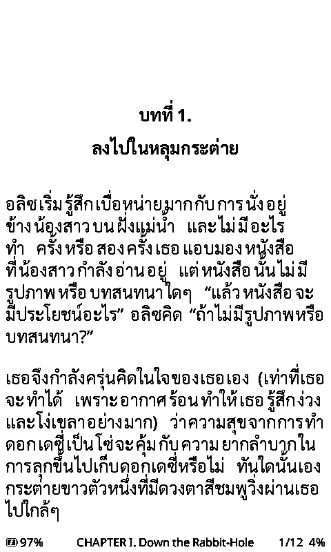

# CrossPoint X4 Thai

**ภาษาไทย** · [English](README.en.md)

เฟิร์มแวร์ส่วนตัวสำหรับ **Xteink X4** ต่อยอดจาก
[CrossPoint Reader 1.6.5](https://github.com/crosspoint-reader/crosspoint-reader/tree/1.6.5)
อ่านภาษาไทยได้ถูกต้อง และมีหน้าหลักที่เน้นปกหนังสือ

  
  
  

ภาพจาก X4 เครื่องจริง หนังสือคือ *Alice's Adventures in Wonderland* (Project Gutenberg, สาธารณสมบัติ) และฉบับแปลไทยที่แปลด้วย epub.lan

## ทำอะไรได้บ้าง

- **อ่านไทยได้ถูกต้อง** ตัดบรรทัดระหว่างคำ ไม่ตัดกลางคำ สระและวรรณยุกต์ซ้อนวางถูกที่
  จัดชิดขอบแล้วไม่มีช่องโหว่กลางประโยค และเมนูทั้งหมดเป็นภาษาไทย
- **คำของเราเอง** ใส่ชื่อตัวละครหรือชื่อสถานที่ไว้ใน `thai-words.txt` แล้วจะไม่ถูกตัดกลางคำอีก
- **ไทยได้ทุกฟอนต์** ฟอนต์จากการ์ด SD ที่ไม่มีอักษรไทยจะยืมตัวไทยจากฟอนต์ในเครื่อง
- **หน้าหลักสองแบบ**
  - **ปกเต็ม:** ปกใหญ่ บทที่อ่านอยู่ และอ่านไปแล้วกี่เปอร์เซ็นต์
  - **มินิมอล:** มีแค่ปกกับไอคอน ไม่มีตัวหนังสือเลย
- **ปกคม เป็นสีเทา** ปกแสดงด้วยเทา 4 ระดับ หนังสือที่ส่งจาก epub.lan
  (ปุ่ม Send to X4 หรือ OPDS ที่ `http://epub.lan/opds`) มีรูปที่ X4 ถอดได้คมชัด
- **นาฬิกา สถิติการอ่าน และแดชบอร์ด** เวลาบนแถบสถานะ สถิติการอ่านในหน้าแอป
  และหน้าจอพักที่เป็นแดชบอร์ด (เลย์เอาต์ HTML ที่แก้เองได้ จาก `server/`)
- **ถนอมการ์ดและแบต** บันทึกตำแหน่งที่อ่านทุก 5 หน้า และไฟล์ XTC อ่านตรงจากการ์ด
- **แอป (Pocket Hub)** ปุ่ม "แอป" บนหน้าหลักเปิดตารางแอป: 2048, เกมกู้ระเบิด, โนโนแกรม, ไพ่ทาโรต์
  (รูปไพ่ Rider-Waite-Smith 1909), แฟลชการ์ด, สถิติการอ่าน และแดชบอร์ด แอปเป็น WebAssembly บนการ์ด
  ติดตั้งเพิ่มได้โดยไม่ต้องแฟลชใหม่ ดาวน์โหลดได้จาก [x4-pocket-apps](https://github.com/AKKatung159/x4-pocket-apps)
  หรือเขียนเองด้วย Pocket SDK ([คู่มือ](docs/personal/pocket-apps/README.md))

  
  
  
  

## ติดตั้ง

ดาวน์โหลดไฟล์ `crosspoint-…-x3-x4.bin` ตัวล่าสุดจาก
[Releases](https://github.com/AKKatung159/crosspoint-x4/releases) แล้วแฟลชผ่าน
[CrossPoint web flasher](https://crosspointreader.com/#flash-tools)
(**X4 → Custom .bin**) จากนั้นไปที่ **Settings → System → Language → ไทย**
วิธีติดตั้งแบบอื่น และวิธีย้อนกลับ: [install.md](docs/personal/install.md)

## ต่อไปจะทำอะไร

เฟส 1–6 เสร็จแล้ว ดู[สิ่งที่แต่ละเฟสเปลี่ยน](docs/personal/changelog.md) ต่อไปอาจทำ: ปลุกเครื่องเองเป็นระยะให้แดชบอร์ดสดตลอด
และให้ epub.lan สร้าง `thai-words.txt` จากอภิธานศัพท์ของแต่ละชุด

## อ่านเพิ่ม

- [สิ่งที่แต่ละเฟสเปลี่ยน](docs/personal/changelog.md) ผลเทียบตัวตัดคำ และข้อจำกัดที่รู้อยู่
- [ติดตั้งและย้อนกลับ](docs/personal/install.md)
- [Build, เทสต์, เทสบนเครื่องจริง, emulator, ออก release](docs/personal/development.md) (ภาษาอังกฤษ)
- [เซิร์ฟเวอร์แดชบอร์ด](server/README.md) (ภาษาอังกฤษ)
- [โค้ดภาษาไทยทำงานยังไง](lib/Thai/README.md) (ภาษาอังกฤษ)
- [สัญญาอนุญาต](docs/personal/licences.md) (ทั้งหมดเป็น MIT, CC0 หรือ OFL)
- [README ของ CrossPoint ต้นฉบับ](docs/upstream-README.md)
