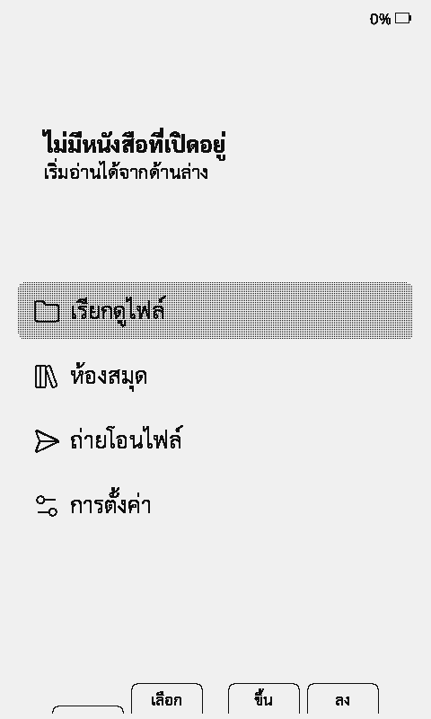
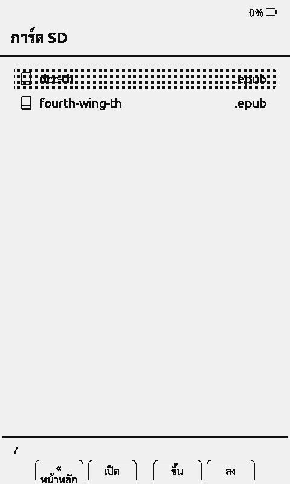
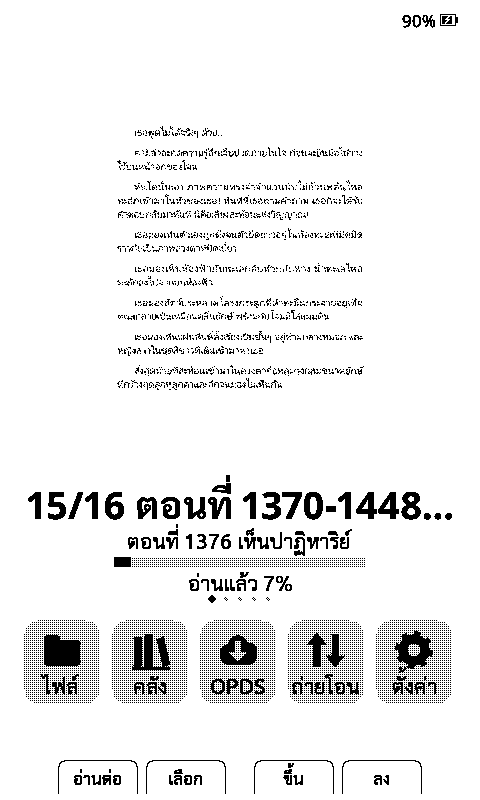
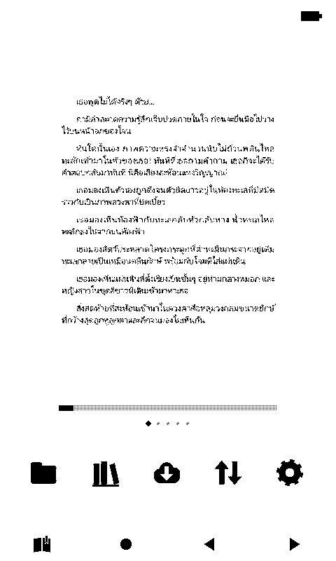

# CrossPoint X4 (personal fork): Thai reading

Personal firmware for an **Xteink X4**, built on upstream
[CrossPoint Reader 1.6.5](https://github.com/crosspoint-reader/crosspoint-reader/tree/1.6.5)
and kept mergeable with it. Phase 1 adds proper Thai reading, phase 2 speed and
battery, phase 3 the home themes; later phases are in the [roadmap](#roadmap).

<p align="center">
  
  
</p>

Screenshots come from the [eink-qemu](https://github.com/serialx/eink-qemu) X4 emulator, running this firmware.

## What phase 1 adds

- **Thai word breaking.** Thai has no spaces between words. Lines break between
  dictionary words (37,883 words, CC0) and never inside a syllable. Unknown
  names wrap only at likely syllable starts. This covers EPUB and TXT.
- **Stacked vowels and tone marks.** Marks such as `ที่ ปั้ม น้ำ ฟื้น กตัญญู` are
  positioned using the C90 variant-glyph rules (ported from CrosspointTH).
- **Justified Thai without holes.** The gaps between Thai words stretch by at most
  1 px; real spaces take the rest. Nothing is ever stretched inside a word.
- **Thai in every built-in font.** Noto Sans/Serif 12–18 in all styles, the UI
  fonts and the status-bar font, using Sarabun's Thai glyphs.
- **Thai UI language.** *Settings → System → Language → ไทย* (all 515 strings).
- **OTA safety.** "Check for update" looks at this repo's releases, so it can
  never replace this build with stock CrossPoint (which has no Thai).

### Phase 2 (1.6.5-th.2)

- **Personal word lists.** Put names and series terms one per line in a
  `thai-words.txt` (UTF-8, `#` for comments) at the card root (all books), in a
  book's folder (one series; epub.lan uses one folder per series), or as
  `<book name>.words.txt` next to the book. They count as dictionary words, so
  `ซาร์ทาเนียลโวลเดอร์ไมเออร์` stays whole instead of breaking at odd places.
  When a list changes, the affected book is laid out again automatically.
- **Thai in any SD font.** SD fonts without Thai (Latin-only `.cpfont`s)
  borrow Thai, including the stacked-mark variants, from the built-in font of
  the nearest size. Lines can look tight with fonts that have a small line
  height; raise line spacing if so.
- **Fewer SD writes.** The reading position is saved every 5 pages and when
  you leave the book or the device sleeps, not on every page turn. A crash or
  dead battery can lose up to 4 pages of position.
- **XTC without big allocations.** Black-and-white XTC pages are drawn
  straight from the card (no 48 KB buffer per page). Grayscale pages fall back
  to black and white if the 96 KB buffer is unavailable, instead of showing an
  error.
- **Fix:** tone marks above `ิ ี ึ ื` (e.g. `ที่`, `เปลี่ยน`) collided with the
  vowel in 1.6.5-th.1.

All of this was tested end to end on a real X4 (see "Testing on a real X4").

### Phase 3 (1.6.5-th.3)

<p align="center">
  
  
</p>

- **Two home themes** (*Settings → Display → UI Theme*, ตั้งค่า → หน้าจอ → ธีมหน้าจอ), Lyra everywhere except
  the home screen:
  - **ปกเต็ม (Cover):** a big cover, the book title, author · current chapter,
    a progress bar with "อ่านแล้ว N%", dots for the last 5 books, and icon
    tiles with short labels.
  - **มินิมอล (ไอคอน) (Minimal):** a bigger cover, the progress bar and icons
    only, with no text at all (the battery and the button hints are icons too).
  - Both use one solid icon set (`scripts/personal/home_icons.py`). Up/Down
    walk the books first, then the tiles. The percent and chapter are saved in
    the book's cache (`home-summary.txt`) when you leave it, so books opened
    only on older firmware show no summary until you read them once.
- **Noto Sans only.** Noto Serif is no longer built in (it saves about 1 MB of
  flash). A saved Serif setting reads as Sans, and SD fonts still work.
  Flash is now 5.04 MB (77%), with about 1.5 MB free.
- **Sharper covers from epub.lan.** On the epub.lan branch
  `x4-baseline-images`, books sent to the X4 (Send to X4 and OPDS) have every
  picture rewritten as a baseline greyscale JPEG at 480×800 or smaller. The X4
  decodes those quickly and cleanly; progressive or large JPEGs used to look
  blocky or fail. (Not merged into epub.lan yet.)

Tested on a real X4: both themes, the home summary after reading, and Thai
reading with Sans only.

The design and every change to upstream files are described in
[lib/Thai/README.md](lib/Thai/README.md).

### Word breaker: why this one

I compared three breakers on 3,000 paragraphs from two Thai books translated by
epub.lan. The reference is PyThaiNLP's `deepcut` (a neural segmenter, independent
of any dictionary). Tool: `scripts/thai/eval_segmentation.py`.

| Breaker | Precision (breaks that are real word boundaries) | Recall (word boundaries offered) |
| --- | --- | --- |
| **This fork** (DP + cluster rules, CC0 dictionary) | **93.5%** | 87.9% |
| Halo 2 v2.2.15 (DP, ORST dictionary) | 91.5% | 94.4% |
| CrosspointTH v1.6.0-th.1.0 (greedy longest match) | 92.2% | 95.3% |

For line breaking, precision matters most: a false break is a word cut in half
at the end of a line. This fork makes the fewest. It keeps some compounds
(`กินข้าว`) whole, which costs recall. Greedy matching also fails on classic
traps, for example `ไปหามเหสี` → `ไป|หาม|เห|สี`.

## Licences

| Source | Licence | Used for |
| --- | --- | --- |
| [crosspoint-reader/crosspoint-reader](https://github.com/crosspoint-reader/crosspoint-reader) 1.6.5 | MIT | the base firmware |
| [JTIAPBNAI/CrosspointTH](https://github.com/JTIAPBNAI/CrosspointTH) v1.6.0-th.1.0 | MIT | Thai shaping rules and tests, SarabunTH fonts, PUA patch script, Thai UI strings, dictionary trie format |
| [kocha01/crosspoint-halo2-custom](https://github.com/kocha01/crosspoint-halo2-custom) v2.2.15 | MIT | ideas only: the DP word-break objective and syllable-aware fallback (reimplemented) |
| [PyThaiNLP](https://github.com/PyThaiNLP/pythainlp) `words_th.txt` | CC0-1.0 | the Thai dictionary |
| [Sarabun](https://github.com/cadsondemak/Sarabun) | SIL OFL 1.1 | Thai glyphs in the built-in fonts (`lib/EpdFont/builtinFonts/source/SarabunTH/OFL.txt`) |

`crosspoint-thai-wordcut` is binary-only and is not used. CrosspointTH's
dictionary (libthai, LGPL-2.1) is not used either.

## Install on the X4

Download `crosspoint-<version>-x3-x4.bin` (for example `crosspoint-1.6.5-th.1-x3-x4.bin`) from this repo's
[Releases](../../releases), or build it (below). It is a normal app image, the
same kind of file as the official `crosspoint-1.6.5-x3-x4.bin`.

**Keep a rollback image before flashing.** From the
[Halo 2 v2.2.15 release](https://github.com/kocha01/crosspoint-halo2-custom/releases/tag/v2.2.15),
`firmware.bin` has SHA-256
`b0156ec5760dce61dafe24bb76f7de58c25a3f0f8ee7f340d69420b09e151929`.

### Option A: web flasher (USB-C, Chrome/Edge)

1. Connect the X4 by USB-C and wake it.
2. Open https://crosspointreader.com/#flash-tools, choose **X4**, then **Custom .bin**, and pick the file.
3. Wait for it to finish, then let the device reboot. Do not unplug while flashing.

### Option B: from the SD card (no computer connection)

1. Copy the `.bin` to the SD card.
2. On the device: **Settings → System → SD Card Firmware Update**, then pick the
   file. Use this only if the firmware currently running has that menu.

### Option C: esptool

```bash
esptool.py --chip esp32c3 --port COM5 --baud 921600 write_flash 0x10000 crosspoint-1.6.5-th.1-x3-x4.bin
```

Use `0x10000` only. Writing elsewhere can break the bootloader or the partition table.

### Rollback

Flash the Halo 2 `firmware.bin` (or the official `crosspoint-1.6.5-x3-x4.bin`)
the same way. Books, progress and settings on the SD card are kept. Each
firmware rebuilds its own layout cache the first time a book is opened.

After installing: **Settings → System → Language → ไทย**. Built-in fonts already
include Thai. SD-card fonts without Thai glyphs show boxes (see Known limits).

## Build (Windows notes)

```bash
pip install https://github.com/pioarduino/platformio-core/archive/refs/tags/v6.1.19.zip
pio run -e x4_th     # -> .pio/build/x4_th/firmware.bin
```

- Run it from **PowerShell or cmd**, not Git Bash: ESP-IDF's installer refuses
  MSYS ("MSys/Mingw is not supported").
- Set `PLATFORMIO_CORE_DIR=C:\pio`. A deep core directory exceeds Windows'
  260-character path limit while unpacking the ESP32 libraries.
- Set `PYTHONUTF8=1` on Thai-locale Windows (code page cp874). Otherwise build
  output containing non-Thai characters crashes PlatformIO's logger.
- Use PlatformIO **6.1.19** (pioarduino) in both your venv and `C:\pio\penv`.
  6.2.x installs SCons 4.11 in the middle of the build, and the link step fails
  with `No module named 'SCons.Tool.FortranCommon'`.

The `x4_th` env lives in `platformio.personal.ini`. It is upstream's
`gh_release` profile plus this fork's version and OTA URL.

Current size: 6,121,456 bytes = 93.2% of the 6.4 MiB app partition
(stock 1.6.5: 5,589,776). That leaves about 430 KB of headroom.

### Host tests

The tests are plain CMake + GoogleTest. On Windows I used `zig c++` (from
`pip install ziglang`) as the compiler.

```bash
cmake -S test -B build/test -G Ninja && cmake --build build/test && ctest --test-dir build/test
```

`test/thai` has 25 tests (word breaking, shaping, justification). The upstream
suites pass as on stock 1.6.5. On Windows, upstream's
`CssParserTest.FailedPromotionRestoresTheOnlyBackupCache` fails (fake-storage
path matching), and `ChapterHtmlSlimParserTest` does not compile
(`path.c_str()` is `wchar_t*`). Both fail the same way on stock 1.6.5. With a
local `.string()` fix, the latter's 16 tests pass with this fork's layout code.

### Testing on a real X4 over USB

`pio run -e x4_th_test` is the same firmware plus two USB-serial commands:
`CMD:PRESS <back|confirm|left|right|up|down|power> [ms]`, which injects a
button press, and `CMD:MEM`. It also logs at debug level. `CMD:SCREENSHOT`
works on every build. `scripts/device/x4test.py` scripts a test run from the PC:

```bash
python scripts/device/x4test.py COM9 log.txt reset press:down press:confirm wait:5 shot:files.png mem
```

Before flashing, back up the whole flash
(`esptool --chip esp32c3 --port COM9 read-flash 0 0x1000000 backup.bin`).
Then write the app with `write-flash 0x10000 firmware.bin`. If the device was
running from the second OTA slot (Halo 2 does), also run
`erase-region 0xe000 0x2000` so the bootloader picks slot 0. To restore
everything exactly: `write-flash 0 backup.bin`.

Windows pitfalls the driver handles: pyserial raises DTR/RTS when it opens the
port, and the C3's USB-Serial/JTAG takes that as a reset, so the driver opens
the port with both lines low. The port also re-enumerates on every reset.
Separately, Git Bash rewrites `-F path=/` into `C:/Program Files/Git/`, so set
`MSYS_NO_PATHCONV=1` when you curl the device's web API.

### Emulator

`scripts/emu/` runs the [eink-qemu](https://github.com/serialx/eink-qemu) 0.5.0
Windows build (riscv32, machine `x4`) without WSL:

```bash
python <eink-qemu>/eink-qemu/mkflash.py --machine x4 .pio/build/x4_th/firmware.bin flash.bin
python scripts/emu/mksd_win.py sd.img 512 books/       # FAT32 card; pyfatfs, no mtools
python scripts/emu/drive_win.py <eink-qemu> flash.bin sd.img log.txt wait:30 press:confirm wait:8 press:confirm wait:45 press:down wait:10 shot:page.png
```

Put `.crosspoint/settings.json` with `{"language":"TH","textAntiAliasing":0}` in
`books/` to boot in Thai. The X4 panel model shows only the anti-aliasing gray
planes in screen dumps, so turn anti-aliasing off for clean captures.

## Known limits (phase 1)

- Lines with no space at all spread their slack across the Thai word gaps, which
  can look loose. The cap is tunable in `lib/Thai/ThaiJustify.h`.
- The Thai Back/Home button label `« หน้าหลัก` wraps onto two lines in the button bar.
- Peak heap during layout of long Thai chapters is about 6 KB lower than stock, because Thai text is split into finer tokens (same-pages emulator run: 30.9 KB vs 36.6 KB minimum free).

## Roadmap

| Phase | Goal | Notes |
| --- | --- | --- |
| **1 (done)** | Thai on 1.6.5 | This release |
| **2 (done)** | Speed and battery | Done in 1.6.5-th.2: XTC pages streamed from SD, progress writes every 5 pages + on exit/sleep, SD-font Thai fallback, personal word lists. Already in upstream 1.6.5: on-demand XTC page tables, lower CPU clock when idle. Still open: have epub.lan write `thai-words.txt` from its series glossary. |
| **3 (done)** | Looks and covers | Done in 1.6.5-th.3: Cover and Minimal home themes, one solid icon set, Noto Sans only (−1 MB flash), and baseline greyscale JPEGs from epub.lan (branch `x4-baseline-images`). Still open: merge and deploy the epub.lan branch. |
| **4** | Status bar and dashboard | A widget status bar (clock, battery, chapter progress). A dashboard image rendered by the homelab (480×800, 1/2-bit) and fetched over Wi-Fi on wake or used as the sleep screen. |
| **5** | Reading stats and sync | CPR-vCodex style stats (time, pages, sessions, finished books), batched SD writes, optional upload to the homelab. OTA from this repo's releases, plus CI for the `x4_th` build. |

Flash budget: about 1.5 MB is left after dropping Noto Serif in phase 3.

---

*Upstream README follows.*

# CrossPoint Reader

[](https://app.royalty.dev/crosspoint-reader/crosspoint-reader)

CrossPoint is open-source e-reader firmware - community-built, fully hackable, free forever. It's maintained by a growing community of developers and readers who believe your device should do what you want - not what a manufacturer decided for you.

### Now running on:
- **ESP32C3-based** Xteink X4 and X3.
- **ESP32S3-based** Xteink X4Pro and X4Classic, Seeed reTerminal Sticky, M5PaperMono

Check [our Devices page](https://crosspointreader.com/devices) for the full list.


> If you're planning to buy an Xteink device, consider purchasing an **X3/X4 Developer Edition** through https://crosspointreader.com. CrossPoint receives a small share of each sale, helping fund development costs.

## What can CrossPoint do?

- **Reader engine**: EPUB 2/3 rendering with embedded-style option, image handling, hyphenation, kerning, adaptive table layouts, native CJK ruby annotations, chapter navigation, footnotes, bookmarks, dictionary lookups ([StarDict](docs/dictionary.md)), go-to-percent, auto page turn, orientation control, focus reading, KOReader progress sync and more.

- **Various formats**: native handling for `.epub`, `.xtc/.xtch`, `.txt`, and `.bmp`.

- **Touch reading**: follow EPUB links and look up words in the dictionary on touch-enabled devices.

- **Screenshots.**

- **Custom fonts**: install your favorite fonts on the SD card.

- **Tilt page turn (X3 and Sticky)**.

- **USB Drive mode (X4Pro)**: access the SD card as USB mass storage.

- **Library workflow**: indexed title/author search, recently-added and alphabetical views, multilingual grouping, folder browser, recent books, and SD-cache management.

- **Wireless workflows**:
  
  - File transfer web UI
  - EPUB Optimizer
  - Web settings UI/API (edit many device settings from browser)
  - WebSocket fast uploads
  - WebDAV handler
  - AP mode (hotspot) and STA mode (join existing Wi-Fi), both with QR helpers
  - Calibre wireless connect flow
  - OPDS browser with saved servers (up to 8), search, pagination, and direct download
  - OTA update checks and installs from GitHub releases

- **Customization**: night mode, multiple themes (Classic, Lyra, Lyra Extended, RoundedRaff), sleep screen modes including transparent overlays, front/side button remapping, status bar controls, power-button behavior, refresh cadence, and more.

- **Localization**: 34 UI languages and counting, including CJK font fallback and RTL support.

### Coming soon:

- More themes.

- Web plugins.

- Bluetooth pageturner.

- Much more! stay tuned.

---

## USB-locked devices (Xteink Unlocker)

Some Xteink units purchased from third-party stores (e.g. AliExpress) ship with USB flashing locked from the factory.
If your device is locked, you will need to use the **Xteink Unlocker** tool available at
https://crosspointreader.com/#unlock-tool before you can flash CrossPoint.

**You do not need this tool if you bought your device directly from xteink.com.** Those units are not locked.

**Not sure if your device is locked?** Power it on, connect the USB-C cable, and try flashing via the web flasher first (see
[Install firmware](#install-firmware) below). If the browser's serial device picker does not show your device, try a different
USB port or browser before assuming the device is locked. Only reach for the unlocker if the device still doesn't appear.

> ### ⚠️ WARNING: READ THIS BEFORE USING THE UNLOCKER ⚠️
> 
> **The only officially supported firmwares in the unlock tool are CrossPoint and CrossInk.**
> 
> Flashing any other firmware on a USB-locked device may **permanently brick the device** or leave it **permanently
> stuck on that firmware with no recovery path**. Once USB flashing is re-locked, your only way back is via OTA, and if
> the firmware you flashed doesn't support OTA, **there is no way out**.

## Install firmware

### Web installer (recommended)

1. Connect your device to your computer via USB-C and wake/unlock the device
2. Go to https://crosspointreader.com/#flash-tools, select your device (X3, X4, Xteink X4Pro, Seeed reTerminal Sticky, or M5PaperMono), and choose an official CrossPoint release.

### Web installer (specific version)

1. Connect your device to your computer via USB-C and wake/unlock the device
2. Download the firmware file for your device from [Releases](https://github.com/crosspoint-reader/crosspoint-reader/releases), or compile yourself.
3. Go to https://crosspointreader.com/#flash-tools, select your device, click "Custom .bin" and upload the firmware file.

### Revert to Official Firmware

To revert to the official firmware, you can also flash the latest official firmware using https://crosspointreader.com/#flash-tools.

### Command line

1. Install [`esptool`](https://github.com/espressif/esptool):

```bash
pip install esptool
```

2. Download the firmware file for your device from the [releases page](https://github.com/crosspoint-reader/crosspoint-reader/releases).
3. Connect your device via USB-C.
4. Find the device port. On Linux, run `dmesg` after connecting. On macOS:

```bash
log stream --predicate 'subsystem == "com.apple.iokit"' --info
```

5. Flash an X3 or X4:

```bash
esptool.py --chip esp32c3 --port /dev/ttyACM0 --baud 921600 write_flash 0x10000 /path/to/firmware.bin
```

   Flash an Xteink X4Pro, Seeed reTerminal Sticky, or M5PaperMono:

```bash
esptool.py --chip esp32s3 --port /dev/ttyACM0 --baud 921600 write_flash 0x10000 /path/to/firmware.bin
```

### Manual

See [Development quick start](#development-quick-start) below.

---

## Custom SD-card fonts

On devices with external RAM enabled in CrossPoint, copy `.ttf`, `.otf`, or `.ttc` files to the SD card and select them as reader fonts. Put one file in `/fonts/` or `/.fonts/`, or put one family's files in a subfolder. See the [SD card font guide](./docs/sd-card-fonts.md) for the folder layout and styles.

On other devices, convert the font to `.cpfont` first. `.cpfont` files also work on devices with external RAM enabled and have better performance. No firmware reflash is needed to add fonts.

To make `.cpfont` files:

1. Go to https://crosspointreader.com/fonts and open the "SD-card font builder" form.
2. Upload up to four styles (regular, bold, italic, bold-italic), set the family name, point sizes, and Unicode range.
3. Download the generated `.cpfont` files.
4. Copy them to your SD card under `/fonts/YourFont/` (or `/.fonts/YourFont/` to hide the folder).
5. Select the font on the device from the font settings.

Conversion runs the firmware repo's `lib/EpdFont/scripts/fontconvert_sdcard.py` script unmodified, so output matches a local host build.

---

## Documentation

- [User Guide](./USER_GUIDE.md)
- [Web server usage](./docs/webserver.md)
- [Web server endpoints](./docs/webserver-endpoints.md)
- [Project scope](./SCOPE.md)
- [Contributing docs](./docs/contributing/README.md)
- [Touch and UI development](./docs/contributing/touch-and-ui.md) - how to build new screens on the FreeInkUI activity bases (UiListActivity and friends), plus build envs for the non-Xteink touch devices

---

## Development quick start

### Prerequisites

- [pioarduino PlatformIO Core](https://github.com/pioarduino/platformio-core) or [VS Code + pioarduino IDE](https://github.com/pioarduino/pioarduino-vscode-ide)
- Python 3.8+
- `clang-format` 21
- USB-C cable supporting data transfer

### Setup

```bash
git clone --recursive https://github.com/crosspoint-reader/crosspoint-reader
cd crosspoint-reader

# if cloned without --recursive:
git submodule update --init --recursive
```

### Nix/NixOS

Nix/NixOS users can enter the development shell with either `nix develop` (flakes) or `nix-shell`:

```bash
nix develop -f nix
# or
nix-shell nix
```

To flash a connected ESP32-C3 device, enable PlatformIO's udev rules in your NixOS configuration:

```nix
services.udev.packages = with pkgs; [ platformio-core.udev ];
```

After rebuilding the system configuration, reconnect the device or reload udev rules.

### Build / flash / monitor

```bash
pio run --target upload
```

### Contributor pre-PR checks

```bash
./bin/clang-format-fix
pio check -e default
pio run -e default
```

### Debugging

After flashing the new features, it’s recommended to capture detailed logs from the serial port.

First, make sure all required Python packages are installed:

```python
python3 -m pip install pyserial colorama matplotlib
```

After that run the script:

```sh
# For Linux
# This was tested on Debian and should work on most Linux systems.
python3 scripts/debugging_monitor.py

# For macOS
python3 scripts/debugging_monitor.py /dev/cu.usbmodem2101
```

Minor adjustments may be required for Windows.

---

## Internals

CrossPoint Reader is pretty aggressive about caching data down to the SD card to minimise RAM usage. The ESP32-C3 only has ~380KB of usable RAM, so we have to be careful. A lot of the decisions made in the design of the firmware were based on this constraint.

### Data caching

The first time chapters of a book are loaded, they are cached to the SD card. Subsequent loads are served from the
cache. This cache directory exists at `.crosspoint` on the SD card. The structure is as follows:

```text
.crosspoint/
├── epub_<hash>/         # one directory per book, named by content hash
│   ├── progress.bin     # reading position (chapter, page, etc.)
│   ├── cover.bmp        # generated cover image
│   ├── book.bin         # metadata: title, author, spine, TOC
│   ├── css_rules.cache  # parsed CSS rule cache
│   ├── img_*            # rendered image cache files
│   └── sections/        # per-chapter layout cache
│       ├── 0.bin
│       ├── 1.bin
│       └── ...
├── settings.json        # device settings
├── state.json           # resume/runtime state
└── recent.json          # recent books list
```

Removing `/.crosspoint` clears all cached metadata and forces a full regeneration on next open. Book deletes, overwrites, and moves done through the firmware or web UI clear or re-key matching caches; manual SD-card edits may leave stale cache directories behind.

For more details on the internal file structures, see the [file formats document](./docs/file-formats.md).

---

## Contributing

Contributions are welcome. If you're new to the codebase, start with the [contributing docs](./docs/contributing/README.md). For things to work on, check the [ideas discussion board](https://github.com/crosspoint-reader/crosspoint-reader/discussions/categories/ideas) — leave a comment before starting so we don't duplicate effort.

Everyone here is a volunteer, so please be respectful and patient. For governance and community expectations, see [GOVERNANCE.md](./GOVERNANCE.md).

---

## Community forks

One of the best things about open source is that anyone can take the code in a different direction. If you need something outside CrossPoint's [scope](./SCOPE.md), check out the community forks:

- [CrossInk](https://github.com/uxjulia/CrossInk) — UX focused with minimal reading stats and broader customizations for the reading experience.

- [papyrix-reader](https://github.com/bigbag/papyrix-reader) — Adds FB2 and MD format support. Actively maintained with Arabic script support. Custom themes.

- [inx](https://github.com/obijuankenobiii/inx) — Completely reimagines the user interface with tabbed navigation.

- [Witch(hunt) Reader](https://github.com/jpirnay/witchhunt-reader) — More faithful CSS styling and background work for slightly snappier interaction. Weather information panel. Markdown support.

**Note:** Many of these features will make their way into CrossPoint over time. Each project chooses its own priorities and tradeoffs.

Want to build your own device? Be sure to check out the [de-link](https://github.com/iandchasse/de-link) project or [OnePage Reader](https://github.com/MoveCall/onepage-reader).

---

CrossPoint Reader is **not affiliated with Xteink or any device manufacturer**.
