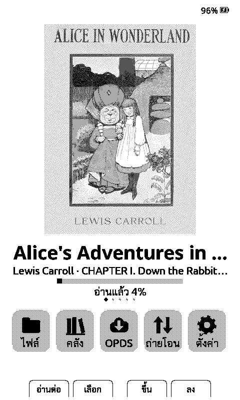
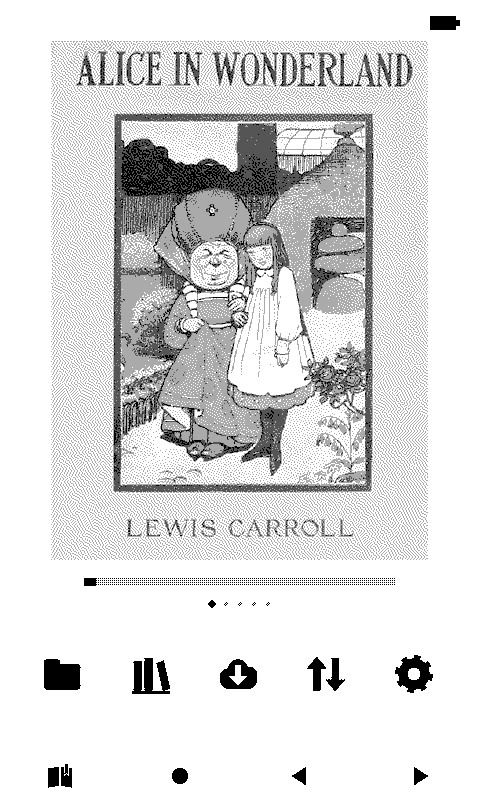
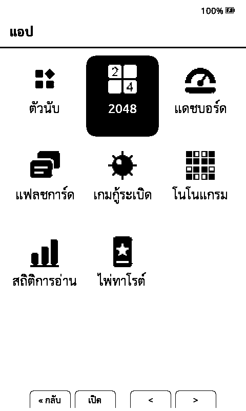
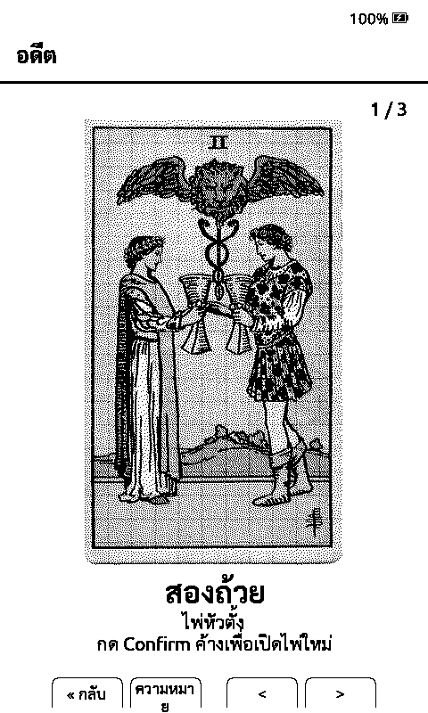
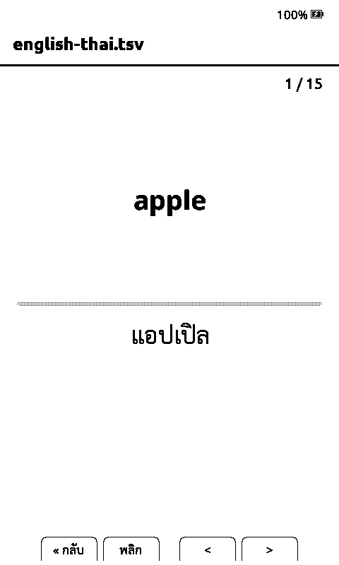

# What each phase changed

[ภาษาไทย](changelog.md) · **English**

Details behind the [README](../../README.en.md). The design of the Thai code and every change to upstream files: [lib/Thai/README.md](../../lib/Thai/README.md).

## Phase 1 (1.6.5-th.1): Thai reading

- **Thai word breaking.** Thai has no spaces between words. Lines break between
  dictionary words (37,883 words in th.1, 53,994 since th.4; CC0) and never inside a syllable. Unknown
  names wrap only at likely syllable starts. This covers EPUB and TXT.
- **Stacked vowels and tone marks.** Marks such as `ที่ ปั้ม น้ำ ฟื้น กตัญญู` are
  positioned using the C90 variant-glyph rules (ported from CrosspointTH).
- **Justified Thai without holes.** The gaps between Thai words stretch by at most
  1 px; real spaces take the rest. Nothing is ever stretched inside a word.
- **Thai in every built-in font.** Noto Sans/Serif 12–18 in all styles, the UI
  fonts and the status-bar font, using Sarabun's Thai glyphs.
- **Thai UI language.** *Settings → System → Language → ไทย* (all 515 strings).
- **OTA safety.** "Check for update" looks at this repo's releases, so it can
  never replace this build with stock CrossPoint (which has no Thai).

## Phase 2 (1.6.5-th.2): speed and battery

- **Personal word lists.** Put names and series terms one per line in a
  `thai-words.txt` (UTF-8, `#` for comments) at the card root (all books), in a
  book's folder (one series; epub.lan uses one folder per series), or as
  `<book name>.words.txt` next to the book. They count as dictionary words, so
  `ซาร์ทาเนียลโวลเดอร์ไมเออร์` stays whole instead of breaking at odd places.
  When a list changes, the affected book is laid out again automatically.
- **Thai in any SD font.** SD fonts without Thai (Latin-only `.cpfont`s)
  borrow Thai, including the stacked-mark variants, from the built-in font of
  the nearest size. Lines can look tight with fonts that have a small line
  height; raise line spacing if so.
- **Fewer SD writes.** The reading position is saved every 5 pages and when
  you leave the book or the device sleeps, not on every page turn. A crash or
  dead battery can lose up to 4 pages of position.
- **XTC without big allocations.** Black-and-white XTC pages are drawn
  straight from the card (no 48 KB buffer per page). Grayscale pages fall back
  to black and white if the 96 KB buffer is unavailable, instead of showing an
  error.
- **Fix:** tone marks above `ิ ี ึ ื` (e.g. `ที่`, `เปลี่ยน`) collided with the
  vowel in 1.6.5-th.1.

All of this was tested end to end on a real X4 (see [development.md](development.md#testing-on-a-real-x4-over-usb)).

## Phase 3 (1.6.5-th.3): looks and covers

  
  

- **Two home themes** (*Settings → Display → UI Theme*, ตั้งค่า → หน้าจอ → ธีมหน้าจอ), Lyra everywhere except
  the home screen:
  - **ปกเต็ม (Cover):** a big cover, the book title, author · current chapter,
    a progress bar with "อ่านแล้ว N%", dots for the last 5 books, and icon
    tiles with short labels.
  - **มินิมอล (ไอคอน) (Minimal):** a bigger cover, the progress bar and icons
    only, with no text at all (the battery and the button hints are icons too).
  - Both use one solid icon set (`scripts/personal/home_icons.py`). Up/Down
    walk the books first, then the tiles. The percent and chapter are saved in
    the book's cache (`home-summary.txt`) when you leave it, so books opened
    only on older firmware show no summary until you read them once.
- **Noto Sans only.** Noto Serif is no longer built in (it saves about 1 MB of
  flash). A saved Serif setting reads as Sans, and SD fonts still work.
  Flash is now 5.04 MB (77%), with about 1.5 MB free.
- **Sharper covers from epub.lan.** Books sent to the X4 (Send to X4 and OPDS)
  have every picture rewritten as a baseline greyscale JPEG at 480×800 or
  smaller. The X4 decodes those quickly and cleanly; progressive or large JPEGs
  used to look blocky (the decoder only reads 1/8 of a progressive JPEG).

Tested on a real X4: both themes, the home summary after reading, and Thai
reading with Sans only.

## 1.6.5-th.4: sharp covers, tidier Thai lines

- **Grey home covers.** The Cover and Minimal themes draw the home cover in 4
  grey levels instead of black-and-white dots: a 2-bit thumbnail
  (`thumbg_<height>.bmp`) plus one grey refresh of just the cover. XTC books
  still use their 1-bit first page.
- **Whole covers.** Covers wider than 0.6 : 1 are shown whole, centred, instead
  of having their sides cut off.
- **Covers come back after a cache wipe.** Home used to need a book's cache to
  build its thumbnail, and otherwise marked the book "no cover" until it was
  opened again. It now reads the cover straight from the EPUB.
- **Fixing books already on the card.** `scripts/personal/x4_fix_covers.py`
  applies epub.lan's picture rewrite to every EPUB on the X4 over Wi-Fi (File
  Transfer mode). It backs each changed book up on the PC first and keeps the
  reading position and home summary (the X4 deletes a book's cache together
  with the book).
- **No more holes in Thai lines.** A Thai word gap now stretches by at most
  3 px; whatever is left stays at the end of the line. Before, a line with no
  real space spread all its slack over the word gaps, which could open 6–8 px
  holes.
- **Bigger dictionary (53,994 words).** The generator used to drop every entry
  of 8+ codepoints that splits into shorter entries, which removed everyday
  words such as `ประโยชน์` (then cut as `ประ|โยชน์` at a line end). The limit
  is now 12. Against deepcut, precision goes from 93.5% to 95.2% and recall
  from 88% to 82% (fewer, safer break points), for 130 KB more flash.
  Books are laid out again once (`SECTION_FILE_VERSION` 50, TXT cache 5).

## 1.6.5-th.5: phases 4 and 5 (clock, dashboard, reading stats)

- **Software clock.** The X4 has no RTC chip (so upstream's `HalClock` never showed a time). It now uses the
  ESP32's system time, set from NTP whenever Wi-Fi is up (again if older than an hour) and kept through deep
  sleep. Before the first sync nothing shows a made-up time. Enabled by `PERSONAL_SOFT_CLOCK`.
- **"Dashboard" sleep screen** (`DashboardSync`). On sleep: join the last network, set the clock, upload stats,
  download `/x4/dashboard.bmp` (480×800, 2-bit grey) and show it; skipped if the last image is under 5 minutes
  old; on failure the last image or the book cover. The server is "Dashboard URL" (default `http://x4.lan`).
- **Dashboard server** (`server/`, image `ghcr.io/akkatung159/x4-hub`). Layouts are HTML + Jinja2, rendered by
  Chromium and reduced to the panel's four greys. Its "Dashboard" page adds, edits, live-previews and picks
  layouts; `/` is a reading-stats page for phones.
- **Reading stats** (`ReadingStats`). Time counts only while pages turn (a gap counts at most 3 minutes); one SD
  write per session. The "Stats" home tile opens the summary.
- **On-device web pages.** One shared theme (`src/network/html/personal/theme.css` + `theme.js`, which swaps
  emoji for solid icons). Three corner values: 20 px cards, 12 px nested surfaces, pills for every control.
  Preview them on a PC with `scripts/personal/web_preview.py`.
- **Fixes:** OTA compares `-th.N`; six home tiles keep their labels.
- **CI:** `.github/workflows/personal.yml` tests and builds every push; a `*-th.*` tag publishes the release.

## 1.6.5-th.9: PDF to XTC in the browser

- **PDF -> XTC before upload** (`src/network/html/personal/pdfxtc.js`, hook `pdf-xtc`), a JavaScript port of
  Epub-Translate's `pdfslice.py`, `xtc.py` and `xtccover.py`: pdf.js renders each page; running headers/footers
  and white margins are dropped; page bodies are flowed and cut into 800x480 strips in the gaps between lines
  (or whole pages in "page" mode); pictures get a Bayer dither, text a 170 threshold; chapters come from the
  outline or "บทที่ N" lines; files are split at 600 screens.
- 1-bit XTC only: an XTCH page needs a 96 KB block on the device.
- pdf.js 4.10.38 from jsDelivr; the first time, it is saved gzipped to `/pdfjs/` on the card (99 KB + 404 KB) and
  used when the CDN cannot be reached.
- Device: `/js/pdfxtc.js`, 10.4 KB gzipped in flash; no RAM.
- Tested in eink-qemu (x4) through the device web server from Chrome: a Thai test PDF gives the same page and
  chapter counts as the Python converter, uploads over WebSocket and reads on the device; the card copy is
  written once and gives byte-identical output offline.

## 1.6.5-th.8: Bluetooth page turner

- **BLE page-turner remotes** (X3/X4), ported from upstream CrossPoint: crosspoint-reader#3785
  (`lib/BlePageTurner`) and #4074 (no radio in a book until a remote is chosen). *Settings → System →
  Bluetooth Page Turner* pairs, forgets and maps remote buttons. The radio runs only with a book open, stops
  before screen changes, sleep and chapter builds, and starts only with room on the heap (64 KB free and a
  32 KB block).
- **Books with thousands of chapters**: #3733 (chapter sizes looked up 2,048 at a time) and #3784 (cumulative
  chapter sizes read from `book.bin` instead of kept in RAM).
- Differences from upstream (hook `ble-port` in `lib/Thai/README.md`): `BleKeyboardHost` is vendored from SDK
  `084fdfb` in `lib/BleKeyboardHost` (this fork's SDK pin predates it); no Save Clipping action (no clippings
  here); the Bluetooth row shows On/Off like Night mode; all 26 strings in Thai.
- **Fix:** the Bluetooth settings cursor moved onto rows that cannot be chosen (upstream too).
- RAM: +9,560 B static (`x4_th` 68,240 B); about 53 KB more heap while the radio runs; flash 90.4%.

## 1.6.5-th.7: X4 Pro support

- **An X4 Pro build** (`x4pro_th` in `platformio.personal.ini`): upstream's `x4pro-gh_release` profile
  (ESP32-S3, PSRAM, GT911 touch, SDMMC card, USB Drive) plus the same personal flags as `x4_th`, now shared
  in `[personal_flags]`. Releases carry two files, `-x3-x4.bin` and `-x4pro.bin`. Each model's OTA picks its
  file by board tag, and OTA and the SD-card update both refuse the other model's image.
- **The clock on the X4 Pro** uses its RTC chip (BM8563). `PERSONAL_SOFT_CLOCK` only applies when no RTC
  is found.
- **Fix:** the Lyra theme had no icon for the "Apps" tile (`UIIcon::Stats`); it now draws `icons/apps.h`
  (lucide layout-grid).
- **CI** builds both `x4_th` and `x4pro_th` on every push and PR.

The X4 Pro is tested in the emulator only (eink-qemu 0.8.1, machine `x4pro`): boot, card, RTC, touch, the
Home key, opening a Thai book, page turns and the Apps grid, with about 200 KB of free heap (plus 8 MB of
PSRAM). It has not been tested on a real device yet.

## 1.6.5-th.6: phase 6 (apps and the Pocket SDK)

  
  
  

- **The Apps grid (Pocket Hub).** The home "Apps" tile (with its own icon) opens a grid of app icons, three
  to a row: Left/Right step a cell, Up/Down a row. Reading stats moved here. Built in: Flashcards, Tarot, 2048,
  Minesweeper and Nonogram. Every app saves to two alternating slots with a CRC, so a write cut off by power
  loss falls back to the previous save.
- **Pocket SDK.** WebAssembly apps (wasm3) in `/apps/<name>/` on the card: `manifest.json`, `app.wasm`,
  `icon.bmp` (32x32, 1-bit) and the app's data, installed by unzipping a `.xpa`, no reflashing. An SDK app
  whose id matches a built-in one replaces it in the grid. The full set is in
  [x4-pocket-apps](https://github.com/AKKatung159/x4-pocket-apps) (Tarot ships all 78 Rider-Waite-Smith 1909
  cards and turns reversed ones upside down). The API is `sdk/include/x4.h` (v2: folder listing, TSV row
  index, 180° images, reading stats, the dashboard image and a Wi-Fi update). A per-call gas budget stops
  runaway apps; each app gets at most 32 KB of memory and returns all of it on exit.
- **Fixes:** Thai button labels in apps were cut mid-character (`ความหมา�`); the test build (`x4_th_test`)
  did not compile because `LOG_LEVEL` was defined twice.

Tested in the emulator (eink-qemu: every app, saves, reopening, sleep and wake, a 2,000-card deck, heap
returned) and on a real X4 (every app, reopening, heap returned).

## Word breaker: why this one

I compared three breakers on 3,000 paragraphs from two Thai books translated by
epub.lan. The reference is PyThaiNLP's `deepcut` (a neural segmenter, independent
of any dictionary). Tool: `scripts/thai/eval_segmentation.py`.

| Breaker | Precision (breaks that are real word boundaries) | Recall (word boundaries offered) |
| --- | --- | --- |
| **This fork** (DP + cluster rules, CC0 dictionary), th.4 | **95.2%** | 82.2% |
| This fork, th.1–th.3 (smaller dictionary) | 93.5% | 87.9% |
| Halo 2 v2.2.15 (DP, ORST dictionary) | 91.5% | 94.4% |
| CrosspointTH v1.6.0-th.1.0 (greedy longest match) | 92.2% | 95.3% |

For line breaking, precision matters most: a false break is a word cut in half
at the end of a line. This fork makes the fewest. It keeps some compounds
(`กินข้าว`) whole, which costs recall. Greedy matching also fails on classic
traps, for example `ไปหามเหสี` → `ไป|หาม|เห|สี`.

## Known limits

- Justified Thai lines with no real space can end a few pixels short of the
  margin (Thai word gaps stretch at most 3 px, `kMaxThaiShareGapPx` in
  `lib/Thai/ThaiJustify.h`).
- The Thai Back/Home button label `« หน้าหลัก` wraps onto two lines in the button bar, and so does Tarot's
  `ความหมาย`.
- The X4 has no USB drive mode (the ESP32-C3 has no USB OTG): apps reach the card by copying files or over
  the web file transfer, which does not overwrite an existing file.
- Peak heap during layout of long Thai chapters is about 6 KB lower than stock, because Thai text is split into finer tokens (same-pages emulator run: 30.9 KB vs 36.6 KB minimum free).
